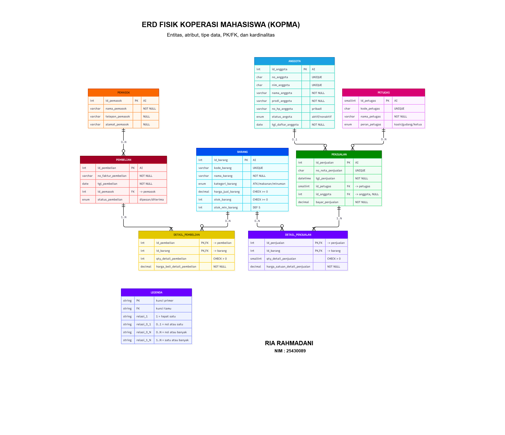
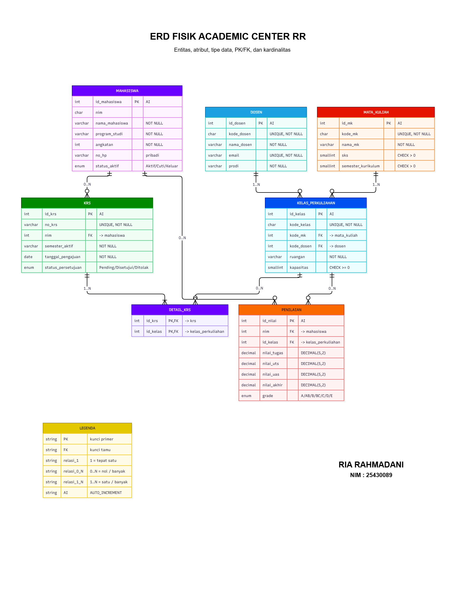

# Laporan Praktikum Basis Data
**Nama:** Ria Rahmadani  
**NIM:** 25430089  
**Kelas:** D  
**Pertemuan:** 3  
**Tanggal:** 2026-10-13  

---

## 1. Tujuan Praktikum
1. Mengidentifikasi entitas, atribut, dan kunci dari dokumen kebutuhan data.
2. Menentukan relasi beserta kardinalitas dan partisipasinya dengan alasan dari aturan bisnis.
3. Memecah relasi banyak-ke-banyak menjadi entitas asosiatif.
4. Menggambar ERD notasi Crow's Foot dan memvalidasinya terhadap kebutuhan informasi (KI) untuk studi kasus latihan (*kopma*) maupun proyek mandiri (*akad_089*).

## 2. Ringkasan Dasar Teori
Model Entity-Relationship menggambarkan data sebagai entitas, atribut, dan relasi. ERD merupakan hasil desain konseptual pada perancangan basis data sebelum menentukan tipe data atau DBMS spesifik. Kardinalitas dan partisipasi digambarkan menggunakan notasi Crow's Foot untuk menunjukkan hubungan maksimum dan minimum antar entitas, yang diturunkan langsung dari aturan bisnis organisasi.

## 3. Hasil Langkah Percobaan
- **ERD Praktikum (Kopma):** 
  - Melakukan perancangan model konseptual untuk studi kasus latihan *kopma*.
  - Menentukan entitas utama seperti `anggota`, `barang`, dan `transaksi`, beserta atribut dan kunci utamanya.
  - Mengatur relasi dan kardinalitas (1 ke M / M ke N) menggunakan notasi Crow's Foot pada draw.io.
  
  
  *Keterangan: Diagram ERD konseptual studi kasus Koperasi Mahasiswa (Kopma) menggunakan notasi Crow's Foot.*

- **ERD Proyek (Academic Center RR - akad_089):**
  - Mengonversi entitas kandidat dari Dokumen Kebutuhan Data proyek mandiri *Academic Center RR* (`akad_089`) menjadi entitas final.
  - Menentukan kunci primer (`PK`), kunci tamu (`FK`), serta atribut pada entitas `mahasiswa`, `dosen`, `mata_kuliah`, `kelas_perkuliahan`, `krs`, `detail_krs`, dan `penilaian`.
  - Menggambar ERD konseptual lengkap dengan notasi Crow's Foot.

  
  *Keterangan: Diagram ERD konseptual proyek mandiri Academic Center RR dengan tema akademik (`akad_089`).*

## 4. Jawaban Titik Analisis
- **Titik Analisis 1:** Penggunaan `id_mahasiswa` atau `nim` sebagai kunci. `nim` tetap dipertahankan sebagai kunci unik (`UNIQUE` / kunci alternatif) karena melekat langsung pada identitas mahasiswa, namun kunci primer menggunakan ID internal untuk menjaga stabilitas relasi apabila terjadi perubahan format NIM di kemudian hari.
- **Titik Analisis 2:** Sisi relasi dari `krs` ke `detail_krs` bernilai satu atau banyak (`1..N`) karena merujuk pada aturan bisnis AB-01 di mana setiap lembar KRS wajib memuat minimal satu mata kuliah.
- **Titik Analisis 3:** Penelusuran jalur peninjauan klien berhasil dibuktikan dengan mencocokkan seluruh kebutuhan informasi (KI-01 sampai KI-05) terhadap relasi entitas pada ERD proyek *akad_089*.

## 5. Hasil Latihan dan Modifikasi
- Berhasil menambahkan pemetaan relasi dan pengujian kardinalitas tambahan berdasarkan parameter proyek ($P=9$).
- Umpan balik dari rekan sejawat ("klien") telah dicatat, di mana penambahan validasi prasyarat mata kuliah disetujui untuk diintegrasikan ke dalam relasi kurikulum.

## 6. Tugas Mandiri: Milestone Proyek 3
- **Pembahasan ERD Kopma:** Model konseptual ini dirancang untuk berfokus pada pencatatan inventaris barang dan transaksi anggota koperasi. Relasi banyak-ke-banyak antara entitas `anggota` dan `barang` dipecah menggunakan entitas asosiatif `transaksi` guna mendata secara rinci kuantitas serta waktu pembelian secara transaksional.
- **Pembahasan ERD Proyek (akad_089):** Model konseptual Academic Center RR dirancang untuk mengakomodasi alur akademik perkuliahan. Relasi antara `krs` dan `mata_kuliah` diuraikan melalui `detail_krs` untuk memastikan satu pengajuan KRS dapat menampung banyak mata kuliah secara fleksibel sesuai aturan bisnis transaksional akademik.
- Pemetaan entitas terhadap proses bisnis (`PB-01` s.d. `PB-06`) dan penelusuran kebutuhan informasi (`KI-01` s.d. `KI-05`) telah lengkap dan terdokumentasi dengan baik untuk kedua model tersebut.

## 7. Pembahasan dan Kendala
- Pada awal perancangan ERD *kopma* dan *akad_089*, sempat terjadi kesalahan peletakan simbol Crow's Foot yang terbalik pada relasi mahasiswa/anggota dengan transaksi/KRS. Kendala diatasi dengan membaca ulang aturan bisnis bahwa satu entitas induk dapat berelasi dengan banyak entitas anak, tetapi entitas anak hanya dimiliki oleh tepat satu entitas induk.

## 8. Kesimpulan
Pemodelan data menggunakan ERD berhasil menjembatani dokumen kebutuhan data tekstual menjadi cetak biru visual yang terstruktur, baik untuk studi kasus latihan (*kopma*) maupun proyek mandiri (*Academic Center RR / akad_089*). Seluruh relasi antar entitas telah divalidasi dan konsisten dengan aturan bisnis masing-masing.

## 9. Pernyataan Penggunaan AI
Menggunakan bantuan AI untuk merapikan format laporan dan struktur teks Markdown sesuai standar praktikum.

## 10. Bukti Git
- **Tautan Repositori:** `https://github.com/Riarahmadani/basisdata_25430089`
- **Hash Commit:** `p03: upload erd kopma dan proyek akad_089`

---

## Checklist
- [x] Identitas lengkap
- [x] Tujuan praktikum dengan bahasa sendiri
- [x] Ringkasan teori maksimal setengah halaman
- [x] Langkah percobaan mencakup ERD Kopma dan Proyek akad_089 beserta templat gambar
- [x] Jawaban Titik Analisis 1-3 lengkap
- [x] Hasil latihan dan modifikasi
- [x] Milestone Proyek 3 (Pembahasan ERD Kopma & ERD Proyek akad_089)
- [x] Pembahasan kendala dan solusi
- [x] Kesimpulan
- [x] Pernyataan penggunaan AI
- [x] Bukti commit Git berformat `PNN:`