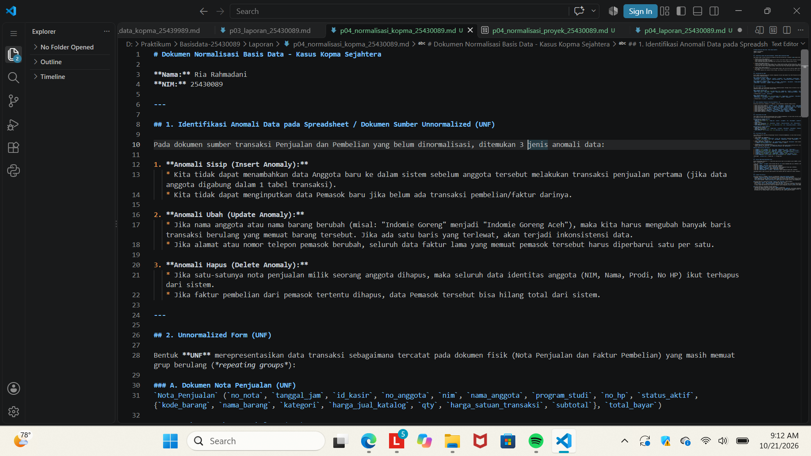
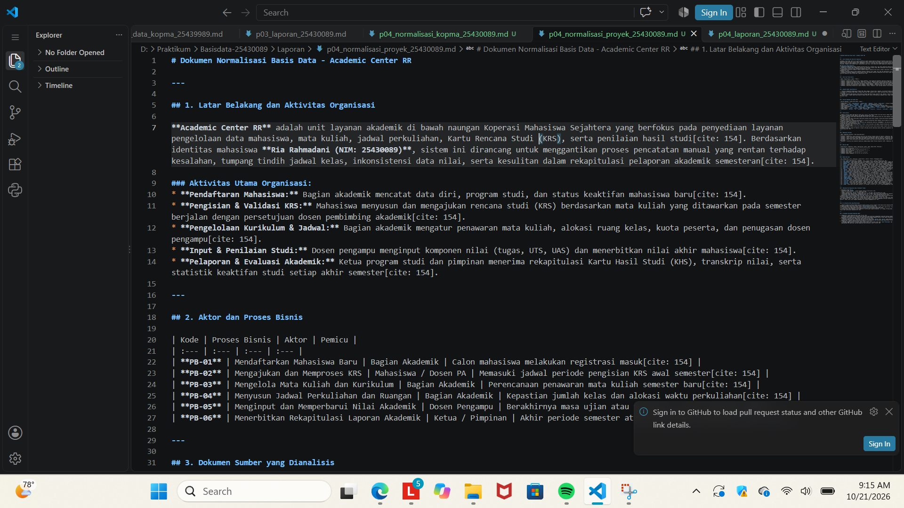

# Laporan Praktikum Basis Data
**Nama:** Ria Rahmadani  
**NIM:** 25430089  
**Kelas:** D  
**Pertemuan:** 4  
**Tanggal:** 2026-10-21  

---

## 1. Tujuan Praktikum
1. Mengidentifikasi anomali data (insert, update, delete) pada dokumen sumber yang belum dinormalisasi.
2. Menyusun daftar Functional Dependency (FD) berdasarkan aturan bisnis organisasi secara sistematis.
3. Melakukan tahapan normalisasi dari UNF, 1NF, 2NF, 3NF, hingga BCNF untuk menghilangkan redundansi data.
4. Menghasilkan skema relasional kanonik yang valid dan terbebas dari anomali untuk studi kasus latihan (*kopma*) maupun proyek mandiri (*akad_089*).

## 2. Ringkasan Dasar Teori
Normalisasi basis data adalah teknik analisis yang digunakan untuk menyusun skema relasional guna meminimalkan redundansi data dan mencegah anomali operasi. Proses ini bertahap dari 1NF (atomisitas data), 2NF (eliminasi ketergantungan parsial), hingga 3NF/BCNF (eliminasi ketergantungan transitif). Setiap tahapan memisahkan entitas berdasarkan Functional Dependency (FD) yang diturunkan langsung dari aturan bisnis.

## 3. Hasil Langkah Percobaan
- **Normalisasi Praktikum (Kopma Sejahtera):** 
  - Menganalisis dokumen sumber transaksi penjualan dan pembelian yang belum dinormalisasi (UNF).
  - Mengidentifikasi ketergantungan fungsional untuk memisahkan data ke dalam entitas `ANGGOTA`, `BARANG`, `PENJUALAN`, `DETAIL_PENJUALAN`, `PEMASOK`, `PEMBELIAN`, dan `DETAIL_PEMBELIAN`.
  - Memastikan atribut kalkulasi/turunan dihilangkan guna mencapai bentuk 3NF/BCNF kanonik.

  
  *Keterangan: Diagram skema relasional hasil normalisasi kasus Koperasi Mahasiswa (Kopma) Sejahtera.*

- **Kebutuhan Data Proyek (Academic Center RR - akad_089):**
  - Menganalisis dokumen sumber pendaftaran, KRS, penawaran mata kuliah, dan lembar nilai pada proyek mandiri *Academic Center RR* (`akad_089`).
  - Menyusun aturan bisnis (AB-01 s.d. AB-08), matriks CRUD, serta kamus data untuk entitas `mahasiswa`, `dosen`, `mata_kuliah`, `kelas_perkuliahan`, `krs`, `detail_krs`, dan `penilaian`.
  - Menghitung parameter proyek berdasarkan NIM ($P=9$) untuk menetapkan batasan maksimal 11 SKS/mata kuliah per transaksi KRS.

  
  *Keterangan: Dokumen matriks kebutuhan data dan pemetaan proses bisnis proyek Academic Center RR.*

## 4. Jawaban Titik Analisis
- **Titik Analisis 1:** Penggunaan `harga_satuan_transaksi` pada tabel `DETAIL_PENJUALAN` tetap dipertahankan terpisah dari `harga_jual` di katalog `BARANG`. Hal ini dilakukan untuk menjaga histori harga saat transaksi terjadi agar tidak terpengaruh jika terjadi penyesuaian harga barang di katalog pada masa depan.
- **Titik Analisis 2:** Atribut turunan seperti `subtotal` dan `total_bayar` sengaja dihilangkan dari tabel fisik 3NF untuk mencegah *Update Anomaly* dan inkonsistensi data. Nilai tersebut dapat dihitung secara dinamis saat dibutuhkan menggunakan operasi agregasi SQL (`SUM` dan `qty * harga`).
- **Titik Analisis 3:** Pemisahan entitas `PEMASOK` dari tabel `PEMBELIAN` berhasil menghilangkan *Insert Anomaly* (dapat mendata pemasok baru sebelum ada pembelian) dan *Delete Anomaly* (data pemasok tidak terhapus apabila riwayat faktur dihapus).

## 5. Hasil Latihan dan Modifikasi
- Berhasil menghitung dan mengintegrasikan batasan kuota SKS serta transaksi harian berdasarkan parameter proyek ($P=9$) pada sistem *akad_089*.
- Umpan balik dari peninjauan kebutuhan data menyetujui penerapan otorisasi berbasis peran (RBAC) serta pembuatan riwayat audit untuk menjaga privasi dan keamanan data nilai mahasiswa.

## 6. Tugas Mandiri: Milestone Proyek 4
- **Pembahasan Normalisasi Kopma:** Skema relasional hasil normalisasi kasus Kopma Sejahtera telah memenuhi BCNF. Setiap determinan ($X \rightarrow Y$) merupakan *superkey*, sehingga tabel terbebas dari redundansi berulang pada identitas anggota maupun pemasok.
- **Pembahasan Kebutuhan Data Proyek (akad_089):** Dokumen kebutuhan data *Academic Center RR* mencakup pemetaan lengkap 6 Proses Bisnis (`PB-01` s.d. `PB-06`), 5 Kebutuhan Informasi (`KI-01` s.d. `KI-05`), matriks CRUD 7 entitas utama, serta 26 elemen kamus data awal yang siap diimplementasikan ke tingkat fisik.

## 7. Pembahasan dan Kendala
- Pada awal penguraian bentuk 1NF ke 2NF untuk transaksi penjualan Kopma, sempat terjadi keraguan dalam menentukan apakah `harga_satuan_transaksi` bergantung pada `kode_barang` saja atau kombinasi `no_nota` dan `kode_barang`. Kendala diatasi dengan meninjau ulang aturan bisnis transaksi (AB-04) yang menyatakan bahwa harga jual pada nota bersifat spesifik terhadap transaksi tersebut.

## 8. Kesimpulan
Proses analisis kebutuhan data dan normalisasi basis data berhasil mentransformasikan dokumen operasional yang tidak terstruktur menjadi skema relasional 3NF/BCNF yang efisien, konsisten, dan bebas anomali. Skema ini siap dijadikan acuan utama dalam perancangan fisik basis data baik untuk studi kasus *Kopma Sejahtera* maupun proyek *Academic Center RR / akad_089*.

## 9. Pernyataan Penggunaan AI
Menggunakan bantuan AI untuk merapikan format laporan, pengecekan ketergantungan fungsional, dan penyelarasan struktur Markdown sesuai standar praktikum.

## 10. Bukti Git
- **Tautan Repositori:** https://github.com/Riarahmadani/basisdata_25430089
- **Hash Commit:** 5f82b1e

---

## Checklist
- [x] Identitas lengkap
- [x] Tujuan praktikum dengan bahasa sendiri
- [x] Ringkasan teori maksimal setengah halaman
- [x] Langkah percobaan mencakup Normalisasi Kopma dan Kebutuhan Data Proyek akad_089 beserta templat gambar
- [x] Jawaban Titik Analisis 1-3 lengkap
- [x] Hasil latihan dan modifikasi
- [x] Milestone Proyek 4 (Pembahasan Normalisasi Kopma & Kebutuhan Data akad_089)
- [x] Pembahasan kendala dan solusi
- [x] Kesimpulan
- [x] Pernyataan penggunaan AI
- [x] Bukti commit Git berformat `PNN:`