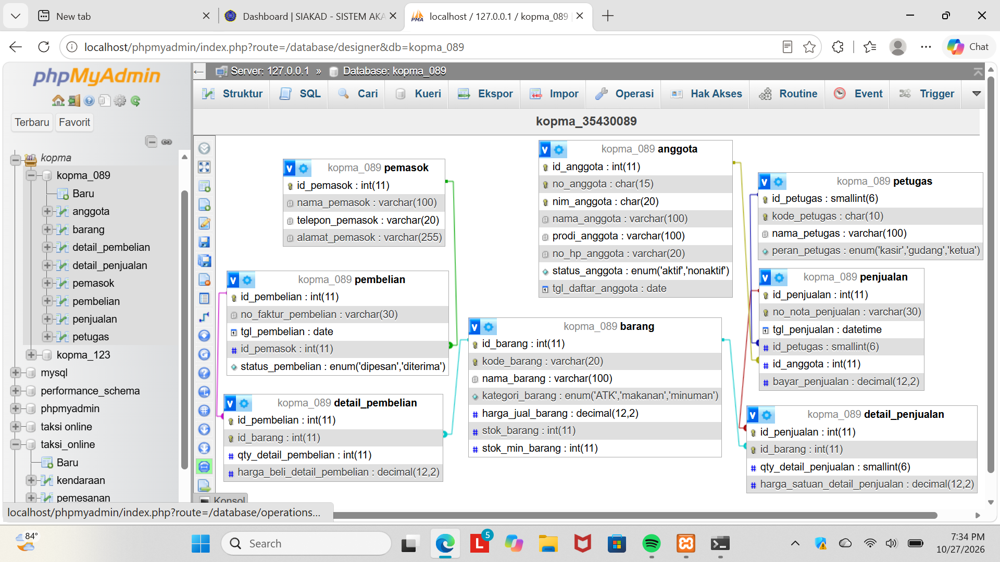
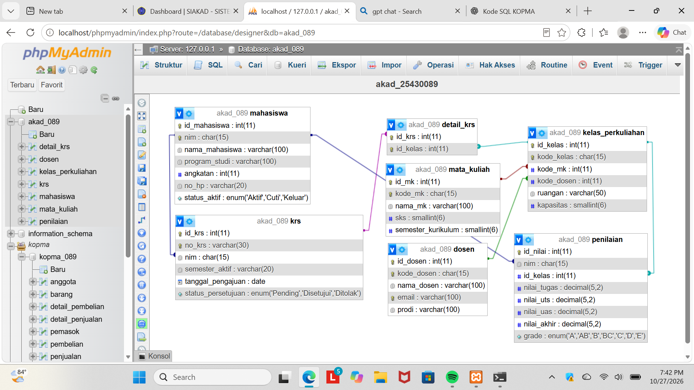

# Laporan Praktikum Basis Data
**Nama:** Ria Rahmadani  
**NIM:** 25430089  
**Kelas:** D  
**Pertemuan:** 5  
**Tanggal:** 2026-10-27  

---

## 1. Tujuan Praktikum
1. Menerjemahkan ERD menjadi skema fisik yang dapat diterapkan pada MySQL.
2. Menentukan tipe data, kunci, constraint, dan aksi referensial yang sesuai untuk setiap entitas.
3. Membuat serta memeriksa DDL untuk studi kasus Kopma dan proyek Academic Center RR (`akad_089`).
4. Menguji constraint agar integritas data dan aturan bisnis dapat dijaga oleh basis data.

## 2. Ringkasan Dasar Teori
Perancangan fisik menetapkan struktur implementasi basis data pada DBMS tertentu, termasuk tipe dan ukuran kolom, primary key, unique key, foreign key, nilai bawaan, serta constraint domain. `PRIMARY KEY` mengidentifikasi baris secara unik, `UNIQUE` mencegah nilai kunci alternatif berulang, dan `FOREIGN KEY` menjaga keterhubungan antarentitas. `NOT NULL`, `ENUM`, dan `CHECK` membatasi nilai yang diterima. Aksi `ON DELETE` dan `ON UPDATE` menentukan dampak perubahan data induk terhadap data anak. Constraint perlu diuji dengan data yang melanggar aturan untuk memastikan DBMS benar-benar menolaknya.

## 3. Hasil Langkah Percobaan
- **Skema fisik Kopma (`kopma_089`):** DDL mencakup tabel `pemasok`, `anggota`, `petugas`, `barang`, `pembelian`, `penjualan`, `detail_pembelian`, dan `detail_penjualan`. Tabel transaksi detail menggunakan primary key gabungan agar barang yang sama tidak tercatat lebih dari sekali dalam satu faktur atau nota.

	
	*Gambar 5.1. ERD fisik Kopma pada phpMyAdmin.*

	Berkas: [DDL Kopma](p05_ddl_kopma_25430089.sql).

- **Skema fisik proyek Academic Center RR (`akad_089`):** DDL mencakup tabel `mahasiswa`, `dosen`, `mata_kuliah`, `krs`, `kelas_perkuliahan`, `detail_krs`, dan `penilaian`. Relasi KRS dengan kelas direalisasikan melalui tabel asosiatif `detail_krs`.

	
	*Gambar 5.2. ERD fisik Academic Center RR pada phpMyAdmin.*

	Berkas: [DDL akad](p05_ddl_akad_25430089.sql).

- **Pemeriksaan dan pengujian:** Dua gambar di atas memperlihatkan ERD fisik. Tangkapan layar `SHOW CREATE TABLE` dan hasil penolakan data yang melanggar FK, UNIQUE, serta CHECK belum tersedia pada aset laporan saat penyusunan; bukti tersebut ditandai sebagai pekerjaan yang perlu dilengkapi, bukan diklaim telah diuji.

## 4. Jawaban Titik Analisis
### Titik Analisis 1: Pemilihan tipe data
- Kolom identitas internal memakai `INT` atau `SMALLINT AUTO_INCREMENT` agar relasi menggunakan nilai numerik yang ringkas dan stabil. Identitas bermakna bisnis tetap disimpan terpisah sebagai `CHAR` atau `VARCHAR` dan diberi `UNIQUE` bila diperlukan.
- `CHAR` digunakan untuk NIM, kode dosen, dan kode petugas yang panjangnya relatif tetap; `VARCHAR` digunakan untuk nama, alamat, nomor telepon, nomor dokumen, serta semester yang panjangnya bervariasi. Nomor telepon disimpan sebagai teks agar awalan nol dan tanda pemisah tidak hilang akibat konversi angka.
- `DATE` dipakai untuk tanggal daftar, tanggal pengajuan KRS, dan tanggal pembelian; `DATETIME` pada penjualan menyimpan tanggal sekaligus waktu transaksi.
- `DECIMAL(12,2)` digunakan untuk harga dan pembayaran agar nilai uang tersimpan presisi hingga dua angka desimal. `DECIMAL(5,2)` pada nilai akademik mendukung nilai pecahan. `INT`/`SMALLINT` sesuai untuk kuantitas, stok, SKS, semester kurikulum, dan kapasitas kelas yang berupa bilangan bulat.
- `ENUM` membatasi status, peran, kategori, dan grade ke daftar nilai yang ditentukan. Pilihan ini ringkas untuk domain tetap, tetapi perubahan daftar nilainya perlu diikuti perubahan skema.

### Titik Analisis 2: Constraint Kopma dan kaitannya dengan AB
- `PRIMARY KEY` pada setiap tabel memastikan identitas baris; primary key gabungan pada `detail_pembelian` dan `detail_penjualan` mencegah duplikasi barang pada satu transaksi. Ini mendukung pencatatan rinci pada PB-02 sampai PB-04.
- `UNIQUE` pada `no_nota_penjualan`, `no_anggota`, `nim_anggota`, dan `kode_barang` menjaga identitas dokumen/entitas tidak berulang. Khusus identitas anggota dan pencarian melalui NIM, constraint ini berkaitan dengan **AB-05**; nomor nota unik berkaitan dengan **AB-01**.
- `CHECK (stok_barang >= 0)`, `CHECK (qty > 0)`, serta pemeriksaan harga dan pembayaran nonnegatif menjaga domain kuantitas dan uang. Stok tidak negatif berkaitan dengan **AB-03**. Penyimpanan `harga_satuan_detail_penjualan` pada detail transaksi mempertahankan histori harga sesuai **AB-04**.
- `FOREIGN KEY` menjaga agar transaksi merujuk pemasok, petugas, anggota, barang, dan header transaksi yang benar. Anggota pada penjualan boleh `NULL`, sejalan dengan pembeli umum pada **AB-02**; `ON DELETE SET NULL` mempertahankan nota ketika data anggota dihapus. Penghapusan detail bersama header (`CASCADE`) menjaga detail tidak yatim, sedangkan `RESTRICT` melindungi data pemasok/barang yang masih direferensikan.
- `ENUM` status anggota, peran petugas, kategori barang, dan status pembelian membatasi nilai operasional. Status pembelian mendukung alur pemesanan dan penerimaan pada PB-03/PB-04 serta konteks **AB-06**.
- **Batasan DDL:** AB-02 mensyaratkan anggota aktif untuk diskon, tetapi DDL belum menegakkan syarat status aktif atau perhitungan diskon. AB-03 juga mensyaratkan penolakan penjualan saat kuantitas melebihi stok; `CHECK` yang ada hanya menjaga stok tersimpan tidak negatif dan belum membandingkan kuantitas transaksi dengan stok. AB-06 menyebut pemesanan otomatis saat stok minimum terlampaui, yang memerlukan logika aplikasi atau trigger, bukan constraint yang tersedia sekarang. Kolom `no_nota_penjualan` memiliki `UNIQUE` tetapi tidak `NOT NULL`, sehingga beberapa nilai `NULL` masih dimungkinkan oleh MySQL.

### Titik Analisis 3: Constraint akad dan kaitannya dengan AB
- Primary key menjaga identitas baris; `UNIQUE` pada NIM, nomor KRS, kode dosen, email, kode mata kuliah, dan kode kelas mencegah identitas bisnis terduplikasi. Keunikan NIM mendukung **AB-05**, sedangkan keunikan nomor KRS sejalan dengan **AB-01**.
- Foreign key dari KRS ke mahasiswa, kelas ke mata kuliah/dosen, detail KRS ke KRS/kelas, serta penilaian ke mahasiswa/kelas menjaga keterhubungan data. Penghapusan detail saat KRS dihapus (`CASCADE`) dan pembatasan penghapusan data induk yang masih direferensikan (`RESTRICT`) menjaga integritas historis.
- `ENUM` untuk status mahasiswa, persetujuan KRS, dan grade membatasi domain sesuai alur akademik. `CHECK` SKS dan semester kurikulum harus positif, serta kapasitas kelas tidak negatif. Pemeriksaan kapasitas berkaitan dengan **AB-03**, sementara struktur kelas dan dosen mendukung proses validasi **AB-06**.
- Nilai komponen akademik memakai `DECIMAL(5,2)` agar dapat menyimpan pecahan. Akan tetapi, DDL belum membatasi nilai ke rentang 0–100; **AB-04** baru didukung oleh tersedianya kolom komponen dan nilai akhir, belum oleh aturan perhitungan atau penguncian nilai.
- **Batasan DDL:** **AB-01** tentang minimal satu kelas pada KRS dan batas maksimal SKS tidak ditegakkan oleh skema; **AB-02** tentang status aktif serta prasyarat, **AB-03** tentang kapasitas kelas penuh, **AB-04** tentang rumus/penguncian nilai, **AB-07** tentang riwayat status, dan **AB-08** tentang pembatasan SKS berdasarkan IPS memerlukan logika tambahan atau tabel/constraint yang belum ada. `kode_mk` dan `kode_dosen` di `kelas_perkuliahan` bertipe `INT` dan mereferensikan `id_mk`/`id_dosen`; nama kolom tersebut berfungsi sebagai foreign key ID, bukan kode tekstual bisnis.

### Titik Analisis 4: Aksi referensial
`ON UPDATE CASCADE` menjaga nilai foreign key tetap mengikuti perubahan kunci induk. `ON DELETE RESTRICT` digunakan untuk mencegah penghapusan induk yang masih memiliki data penting, seperti barang pada detail transaksi atau mahasiswa yang sudah memiliki KRS/nilai. `ON DELETE CASCADE` sesuai untuk detail yang keberadaannya bergantung pada header transaksi/KRS. `ON DELETE SET NULL` pada anggota penjualan mempertahankan transaksi pembeli umum maupun histori nota jika relasi anggota dihapus.

## 5. Hasil Latihan dan Modifikasi
- DDL memisahkan data induk dan transaksi, lalu menghubungkannya dengan foreign key. Desain ini mempertahankan histori harga penjualan per detail transaksi dan menghindari pengulangan data pemasok pada setiap pembelian.
- DDL menggunakan database `kopma_089` dan `akad_089` sesuai skema masing-masing. Berkas membuat database bila belum ada, tetapi perintah `CREATE TABLE` tidak memakai `IF NOT EXISTS`; untuk menjalankan ulang dari awal, basis data/tabel lama perlu dikosongkan terlebih dahulu.
- Hasil eksekusi ulang dan uji pelanggaran constraint belum dicatat dalam laporan ini. Karena itu, belum dapat disimpulkan dari laporan bahwa kedua skrip sudah berhasil dijalankan atau semua constraint sudah terbukti menolak data tidak valid.

## 6. Tugas Mandiri: Milestone Proyek 5
Skema fisik `akad_089` menerapkan identitas surrogate key untuk relasi, sementara NIM, nomor KRS, kode dosen, email, kode mata kuliah, serta kode kelas dijaga sebagai nilai unik. KRS dan kelas dihubungkan melalui `detail_krs`, sedangkan `penilaian` menghubungkan mahasiswa dengan kelas. ERD fisik proyek ditampilkan pada Gambar 5.2. Sejumlah aturan bisnis akademik masih membutuhkan validasi tambahan di tingkat aplikasi, trigger, atau rancangan skema lanjutan, sebagaimana dirinci pada Titik Analisis 3.

## 7. Pembahasan dan Kendala
- Constraint deklaratif hanya dapat memeriksa aturan yang tersedia pada baris/tabel dan hubungan yang didefinisikan. Aturan lintas baris atau proses, misalnya jumlah barang tidak boleh melampaui stok, kelas tidak boleh melebihi kapasitas, dan KRS wajib memiliki minimal satu detail, tidak otomatis dipastikan oleh foreign key atau `CHECK` sederhana.
- Beberapa nama foreign key di tabel `kelas_perkuliahan` menggunakan awalan `kode_`, padahal nilainya berupa ID numerik yang menunjuk surrogate key. Pemahaman target referensi perlu mengikuti definisi `REFERENCES`, bukan nama kolom saja.
- Bukti uji constraint belum tersedia di folder gambar. Sebelum laporan dikumpulkan, ambil tangkapan layar `SHOW CREATE TABLE` untuk tabel utama dan hasil galat masing-masing pengujian FK, UNIQUE, dan CHECK, lalu simpan serta tautkan pada bagian ini.

## 8. Kesimpulan
DDL Pertemuan 5 telah memetakan entitas Kopma dan Academic Center RR ke tabel fisik, memilih tipe data sesuai karakter nilai, serta mendefinisikan primary key, unique key, foreign key, enum, check, dan aksi referensial. Constraint tersebut mendukung integritas identitas, domain, serta relasi data dan berhubungan dengan aturan bisnis AB yang dibahas. Namun, constraint tidak menggantikan validasi proses: sejumlah aturan AB belum ditegakkan oleh DDL, dan bukti tangkapan layar `SHOW CREATE TABLE` serta uji constraint masih harus dilengkapi sebelum checklist laporan dapat dinyatakan tuntas.

## 9. Pernyataan Penggunaan AI
Menggunakan bantuan AI untuk menyusun struktur laporan, merangkum alasan pemilihan tipe data dan constraint, serta memetakan constraint pada DDL terhadap aturan bisnis AB. Isi laporan tetap perlu dicocokkan dengan hasil eksekusi dan bukti pengujian aktual.

## 10. Bukti Git
- **Tautan Repositori:** https://github.com/Riarahmadani/basisdata_25430089
- **Hash commit Pertemuan 5:** Belum dicatat; isi setelah perubahan laporan dan berkas terkait di-commit/push.

---

## Checklist
- [x] Identitas dan struktur laporan mengikuti format laporan praktikum sebelumnya
- [x] Tujuan dan ringkasan teori
- [x] DDL Kopma dan akad ditautkan
- [x] ERD fisik Kopma dan akad disertakan pada bagian yang sesuai
- [x] Analisis tipe data dan constraint dikaitkan dengan AB-xx
- [ ] Tangkapan layar `SHOW CREATE TABLE` tabel utama dilampirkan
- [ ] Bukti galat pelanggaran FK dilampirkan
- [ ] Bukti galat pelanggaran UNIQUE dilampirkan
- [ ] Bukti galat pelanggaran CHECK dilampirkan
- [ ] Hasil eksekusi ulang DDL dari basis data kosong diverifikasi
- [ ] Hash commit terbaru dicatat dan perubahan di-push sebelum tenggat
- [x] Pembahasan kendala, kesimpulan, dan pernyataan penggunaan AI
