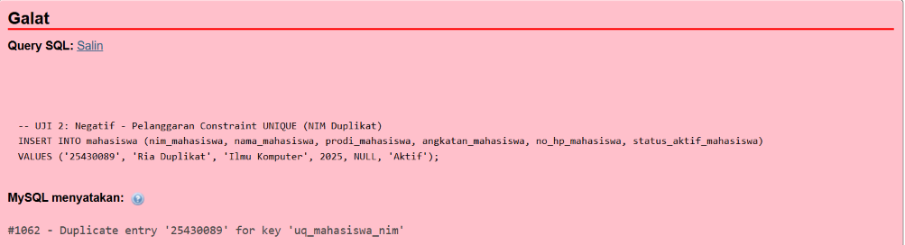
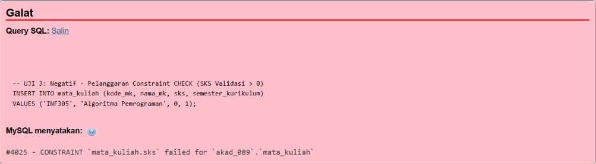
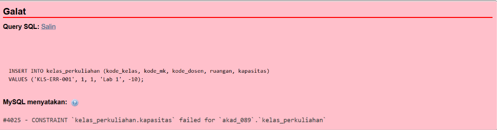
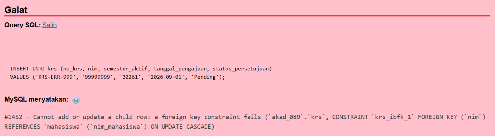
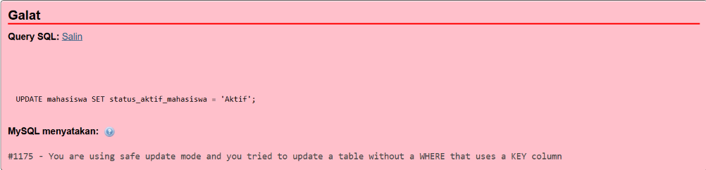

# Laporan Pengujian Data dan Batasan (Constraint) DML - Modul 6

* **NIM**: 25430089
* **Nama**: Ria Rahmadani
* **Database**: `akad_089`
* **Tanggal Uji**: 2026-11-03

---

## Tabel Hasil Skenario Pengujian

| Kode Uji | Jenis Uji | Target / Kategori | Masukan / Perintah SQL | Hasil yang Diharapkan | Hasil Nyata (Terminal / phpMyAdmin) | Status |
| :--- | :--- | :--- | :--- | :--- | :--- | :--- |
| **UJ-01** | Positif | Insert Master | `INSERT INTO mahasiswa ... ('25430005', ...)` | Data mahasiswa baru berhasil disimpan | `Query OK, 1 row affected (0.0021 sec)` | **LULUS** |
| **UJ-02** | Negatif | `UNIQUE` Constraint | `INSERT INTO mahasiswa ... ('25430089', ...)` | Ditolak oleh server karena NIM sudah terdaftar | `ERROR 1062 (23000): Duplicate entry '25430089' for key 'uq_mahasiswa_nim'` (Gambar 6.1) | **LULUS** |
| **UJ-03** | Negatif | `CHECK` Constraint | `INSERT INTO mata_kuliah ... SKS = 0` | Ditolak oleh server karena SKS harus > 0 | `ERROR 4025 (23000): CONSTRAINT constraint_1 failed for akad_089.mata_kuliah` (Gambar 6.2) | **LULUS** |
| **UJ-04** | Negatif | `CHECK` Constraint | `INSERT INTO kelas_perkuliahan ... kapasitas = -10` | Ditolak oleh server karena kapasitas tidak boleh negatif | `ERROR 4025 (23000): CONSTRAINT constraint_1 failed for akad_089.kelas_perkuliahan` (Gambar 6.3) | **LULUS** |
| **UJ-05** | Negatif | `FOREIGN KEY` | `INSERT INTO krs ... nim = '99999999'` | Ditolak karena NIM referensi tidak ada di tabel mahasiswa | `ERROR 1452 (23000): Cannot add or update a child row: a foreign key constraint fails` (Gambar 6.4) | **LULUS** |
| **UJ-06** | Negatif | Mode Aman (`sql_safe_updates`) | `UPDATE mahasiswa SET status_aktif_mahasiswa = 'Aktif'` | Ditolak karena eksekusi UPDATE tanpa klausa WHERE kolom kunci | `ERROR 1175 (42000): You are using safe update mode and you tried to update a table without a WHERE that uses a KEY column` (Gambar 6.5) | **LULUS** |

---

## Bukti Foto Kode Galat

*Gambar 6.1. Insert mahasiswa ditolak karena NIM `25430089` sudah terdaftar (galat #1062).*

*Gambar 6.2. Insert mata kuliah ditolak karena nilai SKS adalah 0 (galat #4025).*

*Gambar 6.3. Insert kelas ditolak karena kapasitas bernilai -10 (galat #4025).*

*Gambar 6.4. Insert KRS ditolak karena NIM `99999999` tidak memiliki pasangan pada tabel `mahasiswa` (galat #1452).*

*Gambar 6.5. UPDATE tanpa klausa WHERE yang memakai kolom kunci ditolak oleh mode aman SQL (galat #1175); ini pengujian perlindungan operasi, bukan constraint integritas data.*

---

## Kesimpulan Pengujian
Pengujian UJ-02 sampai UJ-05 menunjukkan bahwa constraint `UNIQUE`, `CHECK`, dan `FOREIGN KEY` pada database `akad_089` menolak masukan yang melanggar aturan. UJ-01 juga mencatat keberhasilan insert data yang valid. UJ-06 menguji mode aman SQL yang menolak UPDATE tanpa kondisi berbasis kolom kunci; pengujian ini merupakan perlindungan operasi, bukan constraint integritas data. Hasil ini mencakup skenario yang dicatat pada tabel dan tidak menyatakan bahwa seluruh kemungkinan constraint telah diuji.