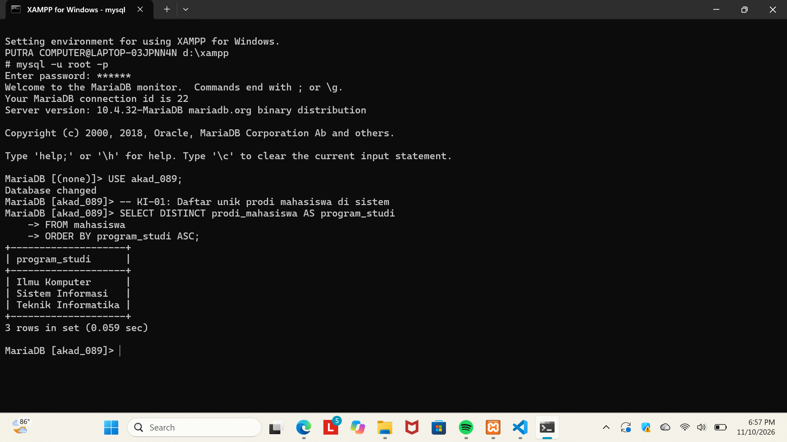
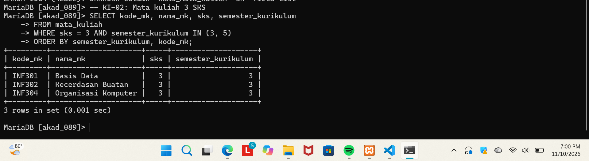
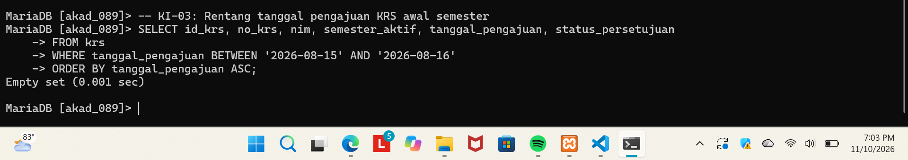
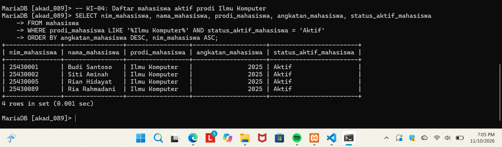
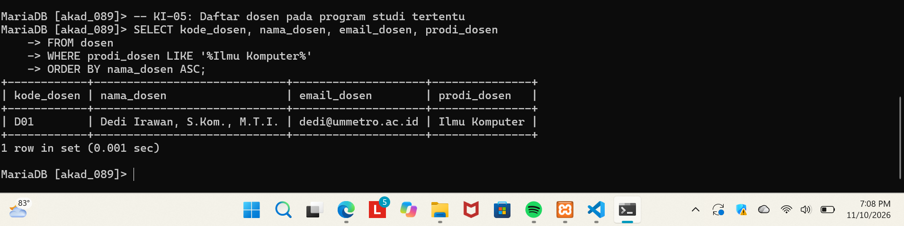
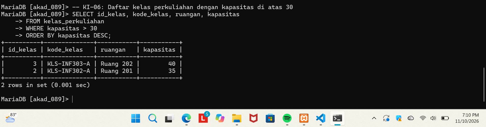
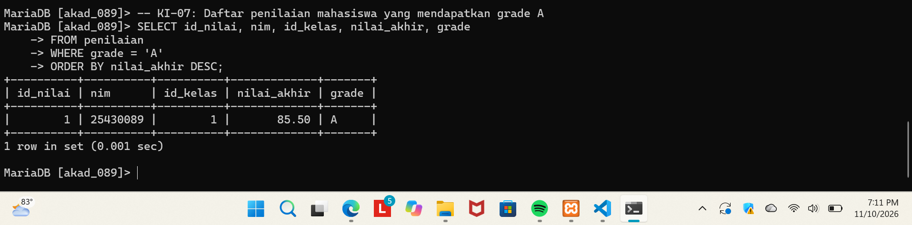
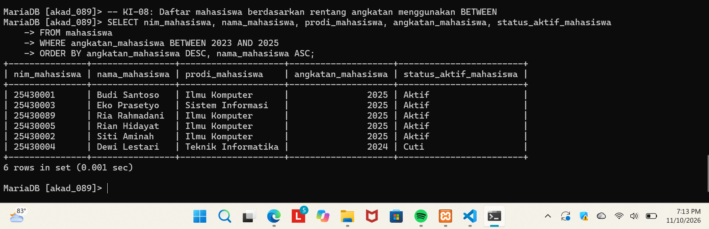
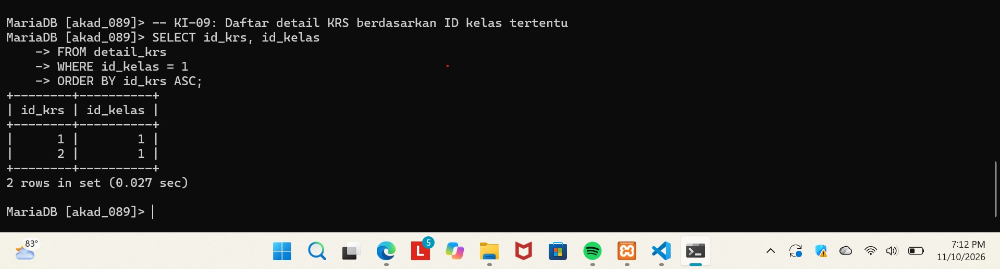
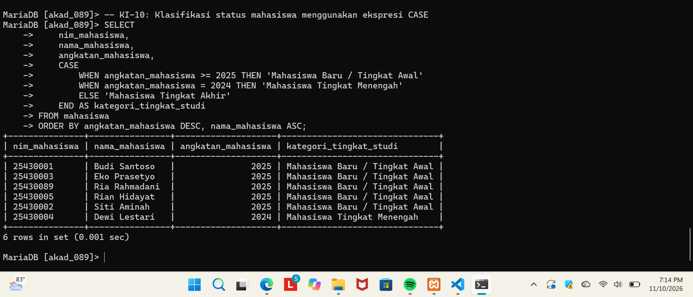

# Laporan Praktikum Basis Data
**Nama:** Ria Rahmadani 
**NIM:** 25430089 
**Kelas:** D 
**Pertemuan:** 7 
**Tanggal:** 10 November 2026 
**Tema proyek:** Akademik (*akad_089*)

---

## 1. Tujuan Praktikum
1. Menggunakan `SELECT` untuk mengambil dan menyaring data dari satu tabel.
2. Mengurutkan, memilih nilai unik, dan membentuk keluaran dengan kondisi.
3. Memeriksa hasil kueri terhadap kebutuhan informasi dan hasil yang diharapkan.
4. Mendokumentasikan alasan pemilihan ekspresi skalar dan bukti hasil setiap kueri.

## 2. Ringkasan Dasar Teori
`SELECT` mengambil kolom dari tabel. `WHERE` membatasi baris berdasarkan kondisi; `IN`, `BETWEEN`, dan `LIKE` membantu menyatakan pilihan nilai, rentang, dan pola teks. `DISTINCT` menghilangkan baris duplikat, sedangkan `ORDER BY` mengurutkan hasil.

Ekspresi kondisional `CASE` menghasilkan satu nilai untuk setiap baris berdasarkan kondisi yang cocok. Fungsi skalar bawaan seperti `UPPER`, `CONCAT`, atau `COALESCE` juga menghasilkan satu nilai per pemanggilan, berbeda dari fungsi agregat yang merangkum banyak baris. Kueri proyek pada pertemuan ini memakai ekspresi `CASE`, tetapi tidak memanggil fungsi skalar bawaan tersebut.

## 3. Hasil Langkah Percobaan
Sepuluh kueri proyek disimpan dalam [p07_kueri_25430089.sql](p07_kueri_25430089.sql). Setiap kueri membaca satu tabel. Hasil aktual berikut dicatat berdasarkan keluaran pada tangkapan layar.

| No. | KI | Kueri dan hasil yang diharapkan | Hasil pada bukti | Tangkapan layar |
|---:|:---:|---|---|---|
| 1 | KI-01 | Menampilkan nama prodi mahasiswa yang unik dan terurut | 3 prodi: Ilmu Komputer, Sistem Informasi, dan Teknik Informatika | [Gambar 7.1](img/p07_01.png) |
| 2 | KI-02 | Menampilkan mata kuliah 3 SKS pada semester kurikulum 3 atau 5 | 3 mata kuliah, seluruhnya semester 3; tidak ada baris semester 5 pada hasil | [Gambar 7.2](img/p07_02.png) |
| 3 | KI-03 | Menampilkan KRS yang tanggal pengajuannya 15–16 Agustus 2026 | Tidak ada baris yang memenuhi rentang tanggal (*empty set*) | [Gambar 7.3](img/p07_03.png) |
| 4 | KI-04 | Menampilkan mahasiswa aktif pada prodi Ilmu Komputer | 4 mahasiswa aktif | [Gambar 7.4](img/p07_04.png) |
| 5 | KI-05 | Menampilkan dosen pada prodi Ilmu Komputer | 1 dosen | [Gambar 7.5](img/p07_05.png) |
| 6 | KI-06 | Menampilkan kelas dengan kapasitas lebih dari 30 mahasiswa | 2 kelas, berkapasitas 40 dan 35 | [Gambar 7.6](img/p07_06.png) |
| 7 | KI-07 | Menampilkan penilaian dengan grade A | 1 baris penilaian | [Gambar 7.7](img/p07_07.png) |
| 8 | KI-08 | Menampilkan mahasiswa angkatan 2023–2025 | 6 mahasiswa | [Gambar 7.8](img/p07_08.png) |
| 9 | KI-09 | Menampilkan detail KRS untuk ID kelas 1 | 2 baris detail KRS | [Gambar 7.9](img/p07_09.png) |
| 10 | KI-10 | Mengelompokkan mahasiswa menurut angkatan dengan `CASE` | 6 mahasiswa: 5 kategori tingkat awal dan 1 kategori tingkat menengah | [Gambar 7.10](img/p07_10.png) |

### Bukti hasil kueri

#### Kueri 1 — KI-01

#### Kueri 2 — KI-02

#### Kueri 3 — KI-03

#### Kueri 4 — KI-04

#### Kueri 5 — KI-05

#### Kueri 6 — KI-06

#### Kueri 7 — KI-07

#### Kueri 8 — KI-08

#### Kueri 9 — KI-09

#### Kueri 10 — KI-10

## 4. Analisis dan Pemetaan Kueri → KI
Kode KI-01 sampai KI-10 pada berkas SQL mengidentifikasi kebutuhan informasi operasional yang diperiksa oleh masing-masing kueri P07. Kode ini digunakan sebagai pemetaan untuk latihan satu tabel, bukan sebagai pengganti KI bisnis proyek yang dirumuskan pada pertemuan sebelumnya.

| Kode KI | Kueri | Informasi yang diperoleh | Teknik utama |
|:---:|---:|---|---|
| KI-01 | 1 | Daftar program studi tanpa pengulangan | `DISTINCT`, `ORDER BY` |
| KI-02 | 2 | Mata kuliah 3 SKS pada semester kurikulum 3 atau 5 | `AND`, `IN`, `ORDER BY` |
| KI-03 | 3 | Pengajuan KRS pada rentang tanggal tertentu | `BETWEEN`, `ORDER BY` |
| KI-04 | 4 | Mahasiswa aktif dari prodi Ilmu Komputer | `LIKE`, `AND`, `ORDER BY` |
| KI-05 | 5 | Dosen dari prodi Ilmu Komputer | `LIKE`, `ORDER BY` |
| KI-06 | 6 | Kelas dengan kapasitas lebih dari 30 | Operator pembanding `>`, `ORDER BY` |
| KI-07 | 7 | Penilaian dengan grade A | Operator `=`, `ORDER BY` |
| KI-08 | 8 | Mahasiswa dalam rentang angkatan 2023–2025 | `BETWEEN`, `ORDER BY` |
| KI-09 | 9 | Detail KRS untuk kelas dengan ID 1 | Operator `=`, `ORDER BY` |
| KI-10 | 10 | Kategori tingkat studi mahasiswa berdasarkan tahun angkatan | Ekspresi kondisional `CASE` |

Kueri P07 berfokus pada satu tabel sehingga menghasilkan potongan informasi, bukan keseluruhan laporan bisnis yang memerlukan gabungan beberapa tabel. Sebagai contoh, kueri mahasiswa aktif pada KI-04 belum menghitung jumlah mahasiswa dan KRS per program studi seperti kebutuhan rekapitulasi proyek.

## 5. Alasan Pemilihan Fungsi/Ekspresi Skalar
Kueri ke-10 menggunakan ekspresi `CASE` untuk mengubah nilai tahun angkatan menjadi label tingkat studi pada setiap baris. Bentuk ini dipilih karena kategori dapat ditentukan dengan beberapa rentang kondisi secara berurutan: angkatan 2025 ke atas mendapat kategori tingkat awal, angkatan 2024 mendapat kategori tingkat menengah, dan nilai lainnya masuk kategori tingkat akhir. Hasilnya merupakan satu nilai kategori per mahasiswa.

Secara istilah SQL, `CASE` adalah ekspresi kondisional yang menghasilkan nilai skalar, bukan nama fungsi bawaan seperti `CONCAT()` atau `UPPER()`. Kueri lain menggunakan operator, predikat, atau klausa SQL (`DISTINCT`, `IN`, `BETWEEN`, `LIKE`, dan pengurutan), bukan fungsi skalar. Karena tangkapan layar merekam kueri tersebut, fungsi bawaan tambahan tidak disisipkan hanya untuk mengklaim penggunaannya.

## 6. Pembahasan dan Kendala
1. KI-03 menghasilkan *empty set*. Ini berarti tidak ada baris yang cocok dengan tanggal yang diminta pada data saat tangkapan layar dibuat; hasil kosong tersebut bukan bukti bahwa kueri gagal.
2. KI-02 mengembalikan tiga mata kuliah pada semester 3. Tidak ada mata kuliah semester 5 yang tampak pada hasil, walaupun semester 5 termasuk kondisi kueri.
3. KI-10 membentuk kategori berdasarkan angkatan, bukan membaca kolom status aktif. Karena itu, keluaran yang tepat dipahami sebagai klasifikasi tingkat studi, sebagaimana nama kolom `kategori_tingkat_studi`.
4. Bukti yang disediakan menunjukkan hasil kueri pada basis data `akad_089`. Jumlah baris dan isi dapat berubah jika data di basis data berubah.

## 7. Kesimpulan
Sepuluh kueri satu tabel berhasil didokumentasikan dengan label KI, keluaran yang diharapkan, dan bukti hasil. Praktikum memperlihatkan penggunaan pemilihan nilai unik, penyaringan kondisi, rentang, pola teks, pengurutan, serta ekspresi `CASE`. Hasil aktual cocok dengan bukti yang tersedia, termasuk keluaran kosong pada KI-03. Kueri-kueri ini mendukung pemeriksaan informasi dasar, tetapi belum menggantikan kebutuhan laporan proyek yang membutuhkan relasi antartabel.

## 8. Pernyataan Penggunaan AI
Menggunakan bantuan AI untuk menyusun struktur laporan, merangkum hasil yang terlihat pada tangkapan layar, dan memeriksa pemetaan kueri. Uraian hasil aktual didasarkan pada bukti tangkapan layar yang tersedia.

## 9. Bukti Repositori
- **Repository:** [basisdata_25430089](https://github.com/Riarahmadani/basisdata_25430089)
- **Berkas kueri:** [p07_kueri_25430089.sql](p07_kueri_25430089.sql)

## Checklist
- [x] Laporan disimpan dengan nama `p07_laporan_25430089.md`
- [x] Berkas `p07_kueri_25430089.sql` memuat 10 kueri satu tabel, masing-masing berlabel KI dan hasil yang diharapkan
- [x] Hasil setiap kueri memiliki tangkapan layar
- [x] Analisis memetakan kueri ke KI
- [x] Alasan pemilihan ekspresi skalar `CASE` dijelaskan secara teknis
- [x] Struktur laporan memuat tujuan, dasar teori, hasil, analisis, pembahasan, kesimpulan, dan pernyataan penggunaan AI